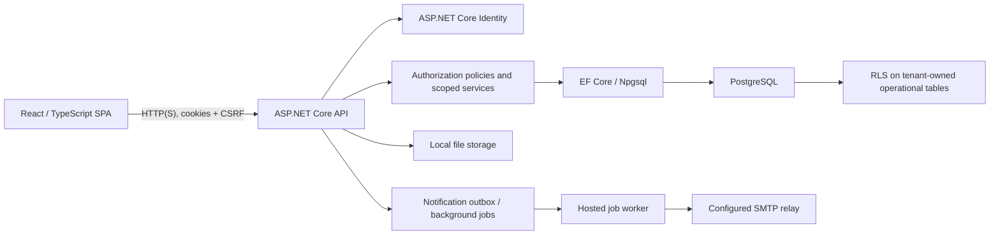
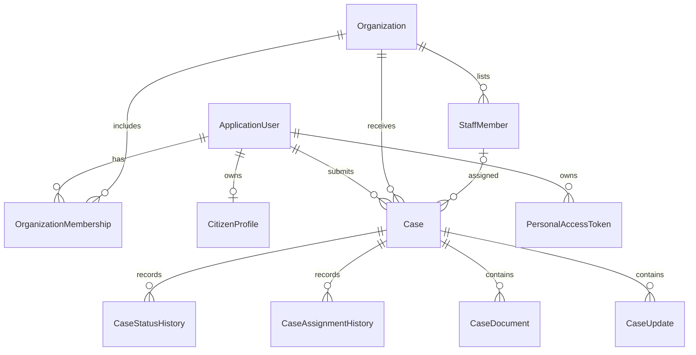
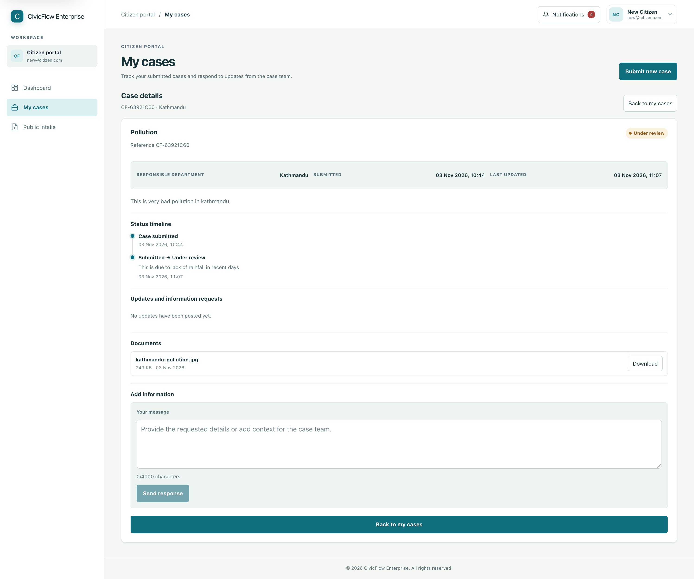
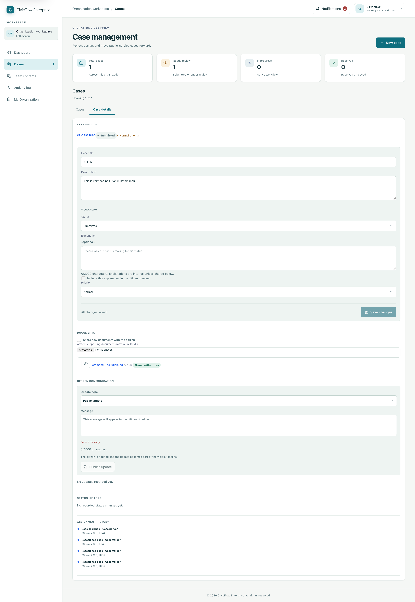
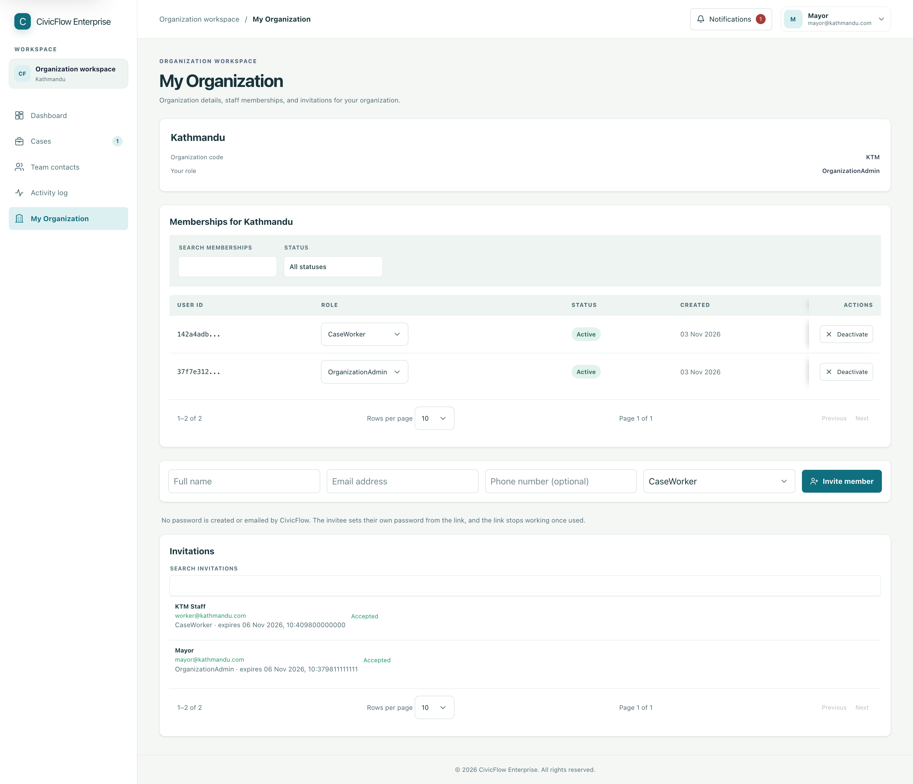
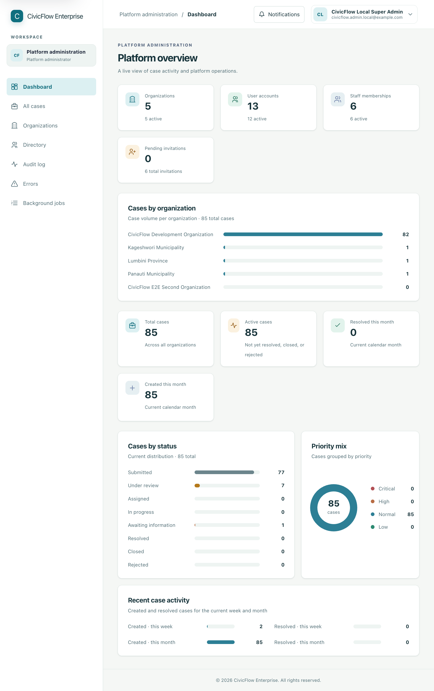
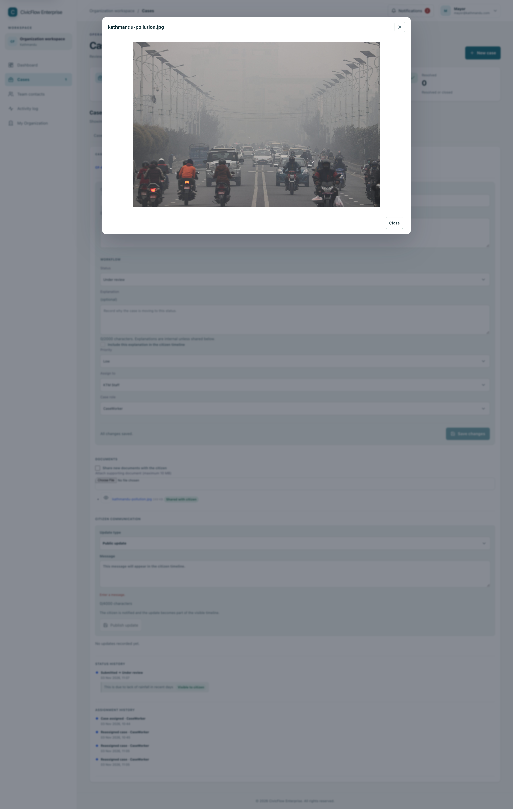

# CivicFlow Enterprise

CivicFlow Enterprise is a multi-organization public-service case-management
application. It gives citizens a secure way to submit and track service
requests, and gives public agencies tools to triage, assign, and resolve them.

The application separates platform administration from organization
operations. Citizens see only their own cases; organization staff work within
an active organization membership and cases they are authorized to access.

## Project overview

| User group | Primary responsibilities |
|---|---|
| Platform Admin (`SuperAdmin`) | Provision organizations and platform accounts, administer the organization-type catalogue, inspect platform-wide directories and cases, and review audit, error, and background-job information. |
| Organization Admin | Manage the active organization's staff and invitations, triage and assign its cases, communicate with citizens, and maintain case status. |
| Staff (`CaseWorker` or `Viewer`) | Work in an active organization. A case worker can modify cases assigned to them; a viewer can read cases assigned to them. |
| Citizen | Register and verify an account, submit service requests, see case progress, and respond to information requests on their own cases. |

Platform roles and organization membership roles are distinct. A user's
organization selector identifies a membership to validate; it does not grant
access by itself.

## Key features

- Citizen registration, email verification, sign-in, password recovery, and
  profile management.
- Organization and organization-type administration.
- Organization memberships, staff directory records, and single-use invitations.
- Citizen case intake, case assignment, status transitions, and paginated
  case lists.
- Citizen case tracking, public status updates, information requests, and
  citizen responses.
- Internal case notes and documents with separate citizen-visible and
  internal visibility.
- Authorized document preview and download through API routes.
- Organization and platform audit views, account directories, and application
  error records.
- In-app notifications and a PostgreSQL-backed background-job worker for
  notification email delivery.
- Platform-wide case inspection for platform administrators.

The endpoint inventory in
[docs/API-AUTHORIZATION.md](docs/API-AUTHORIZATION.md) is the source of truth
for API behavior and role requirements.

## Technology stack

| Technology | Responsibility |
|---|---|
| .NET 10 / ASP.NET Core | HTTP API, middleware, authentication, authorization, and hosted background processing. |
| ASP.NET Core Identity | Account and password management, role store, verification, recovery, lockout, and cookie sessions. |
| Entity Framework Core 10 | Data access, database model, and migrations. |
| PostgreSQL 17 / Npgsql | Application persistence, database constraints, transactions, and tenant row-level security. |
| React 19, TypeScript 6, Vite 8 | Single-page web application and development server. |
| Swashbuckle / OpenAPI | Development-only interactive API reference and request/response schemas. |
| xUnit and ASP.NET Core integration testing | Backend unit, integration, authentication, and API authorization tests. |
| Playwright | Browser end-to-end journeys against a disposable PostgreSQL database. |
| Docker Compose | Local PostgreSQL and containerized application definitions. |

## Architecture

The API is organized by feature. Controllers bind and validate HTTP requests;
feature services apply business rules; domain types express core state; and
`CivicFlowDbContext` maps Identity and application data. The React application
calls the API through shared API helpers and uses shared components for
navigation, forms, dialogs, notifications, and case views.

Browser authentication uses an ASP.NET Core Identity cookie. Unsafe cookie
requests require an antiforgery token. API clients can authenticate with a
personal access token or exchange one for a short-lived JWT. The API resolves
current accounts and memberships from validated identity and database state.

Organization access is checked in application policy/service code and
reinforced by PostgreSQL RLS on six operational tables: cases, case status
history, case assignment history, case documents, staff members, and case
updates. Citizen access uses an authenticated-user context and exposes only
the citizen's own cases and citizen-visible case information. More detail is
available in [docs/RLS-DESIGN.md](docs/RLS-DESIGN.md).

Documents are stored under the API's configured local file-storage root;
database records hold metadata and storage keys. Reads and writes go through
authorized API endpoints. The hosted worker claims and retries persisted
background jobs; the registered job type is `notification.email`.

## Roles and permission boundaries

| Capability | Platform Admin | Organization Admin | Staff | Citizen |
|---|---|---|---|---|
| Platform-wide organization and account administration | Yes, on explicitly protected routes | No | No | No |
| Organization membership and staff management | Platform-wide provisioning | Active organization only | Read-only organization contacts where permitted | No |
| Organization case list and triage | Read-only platform case inspection | Active organization | Assigned cases only | Own cases only |
| Modify a case | No platform case mutation | Active organization | Assigned `CaseWorker` cases only | No |
| View an assigned case | Platform case inspection | Active organization | Assigned `CaseWorker` and `Viewer` cases | Own cases only |
| Add internal notes or internal-only documents | No platform case mutation | Active organization | Assigned case and applicable staff permissions | Never |
| Citizen-visible updates and responses | No platform case mutation | Active organization | Assigned case and applicable staff permissions | Respond to own eligible cases |

An unassigned staff member cannot access a case. A `Viewer` assignment is
read-only; an assigned `CaseWorker` can make permitted changes. Organization
Admins can manage cases in their active organization. Platform case inspection
is read-only and requires the platform-level role. Membership and platform
role assignment are protected by backend authorization, not frontend
visibility.

## Authentication and security

- Passwords are managed and hashed by ASP.NET Core Identity. Registration and
  invitation acceptance never return stored credentials.
- Passwords must be at least 12 characters and satisfy the configured Identity
  requirements for digits, lowercase, uppercase, non-alphanumeric characters,
  and unique characters. Account lockout is enabled after five failed attempts
  for 15 minutes.
- Email confirmation is required for password sign-in. Password recovery and
  registration responses avoid revealing whether an email address is
  registered.
- Browser sessions use HttpOnly, SameSite=Lax cookies. Cookies are Secure on
  non-development deployments; unsafe cookie-authenticated API requests
  require CSRF validation. Logout clears the cookie session.
- Personal access tokens are stored as hashes and shown only once. Exchanging a
  PAT produces a short-lived JWT; revoking the source PAT invalidates JWTs
  issued from it.
- Platform roles and organization memberships are resolved from server-side
  identity/database state. Resource access is additionally checked for each
  case, document, and organization route.
- PostgreSQL runtime connections use a non-owner role that cannot bypass RLS.
  Identity and membership-resolution tables are not RLS-protected; their access
  is controlled by Identity and application authorization.
- Document access checks the caller's case-level permission and document
  visibility before opening a file. Local storage paths are not returned by
  metadata APIs.
- Development email is not delivered unless SMTP is configured. When it is
  unconfigured, the API prints each message, including its one-time
  verification, reset, or invitation link, to the console. A TLS-enabled SMTP
  relay is required outside Development.

Security and endpoint details are maintained in
[docs/API-AUTHORIZATION.md](docs/API-AUTHORIZATION.md) and
[docs/RLS-DESIGN.md](docs/RLS-DESIGN.md).

## Database and data model

Core records include Identity accounts, organizations, organization
memberships, staff directory entries, citizen profiles, cases, case updates,
status and assignment history, documents, notifications, audit events, and
background jobs.

EF Core migrations are under
`PublicServiceCaseManagement.Api/Migrations`.
The API does not apply migrations automatically at startup. Compose
initialization creates separate PostgreSQL `civicflow_migrator` and
`civicflow_runtime` roles; migrations use the former and the running API should
use the latter. The runtime role has DML access and cannot bypass RLS.

Local development database and migration commands are in
[docs/LOCAL-DEVELOPMENT.md](docs/LOCAL-DEVELOPMENT.md). RLS policies and the
opt-in PostgreSQL verification suite are described in
[docs/RLS-DESIGN.md](docs/RLS-DESIGN.md).

## Local development

The API launch profile listens on `http://localhost:5001` and
`https://localhost:7001`. Vite defaults to `http://localhost:5173` and refuses
to silently switch ports. The root Compose configuration also defines
containerized API and frontend services; its database port is bound to
loopback.

The complete setup—including PostgreSQL startup, local secrets, migrations,
API and frontend commands, HTTPS certificate setup, Swagger, and tests—is in
[docs/LOCAL-DEVELOPMENT.md](docs/LOCAL-DEVELOPMENT.md). Local HTTPS uses the
.NET development certificate; certificate exports and passwords must remain
local and untracked.

Business endpoints are disabled by default through
`BusinessEndpoints:Enabled=false`. Enable them explicitly in local user
secrets when exercising organization workflows.

## API documentation

Swagger UI is available only in the Development environment at
`/swagger`. It documents the current-user (`/me`) convention, endpoints that
use authenticated-user scope or collection/body/query inputs instead of
resource IDs, and reusable DTO schemas. Swagger's request interceptor obtains
CSRF tokens for unsafe same-origin cookie requests.

See the [API contract and authorization matrix](docs/API-AUTHORIZATION.md) for
route purposes, request shapes, permissions, pagination, validation, and
response examples. The `Schemas` section in Swagger describes reusable API
models, not database entities.

## Testing

| Suite | Command | Notes |
|---|---|---|
| Backend build | `dotnet build PublicServiceCaseManagement.sln --configuration Release` | Builds the API and test projects. |
| Backend tests | `dotnet test PublicServiceCaseManagement.sln --configuration Release` | Includes unit and API integration coverage; PostgreSQL-only RLS tests require disposable database settings. |
| Frontend lint | From `civicflow-web`: `npm run lint` | ESLint. |
| Frontend build/type check | From `civicflow-web`: `npm run build` | Runs TypeScript project build and Vite production build. |
| E2E configuration type check | From `civicflow-web`: `npm run typecheck:e2e` | Checks Playwright TypeScript. |
| Browser end-to-end tests | From `civicflow-web`: `npm run test:e2e` | Requires Chromium and a disposable PostgreSQL database; see the local-development guide. |

There is no separate frontend unit-test script in the current package
configuration. The RLS and browser suites must use disposable databases, never
a shared or production database. Coverage and environment requirements are
documented in [docs/INTEGRATION-VERIFICATION.md](docs/INTEGRATION-VERIFICATION.md).

## Project structure

| Path | Contents |
|---|---|
| `PublicServiceCaseManagement.Api/Features/` | API controllers, contracts/DTOs, and feature services. |
| `PublicServiceCaseManagement.Api/Domain/` | Core entities, value types, and business rules. |
| `PublicServiceCaseManagement.Api/Infrastructure/Authorization/` | Policies and resource authorization support. |
| `PublicServiceCaseManagement.Api/Infrastructure/Identity/` | Identity setup, token handlers, email senders, and user seeding. |
| `PublicServiceCaseManagement.Api/Infrastructure/Persistence/` | EF Core context and migrations. |
| `PublicServiceCaseManagement.Api/Infrastructure/Files/` | Document storage and file access. |
| `civicflow-web/src/pages/` | Route-level frontend pages. |
| `civicflow-web/src/components/` | Shared components and feature workspaces. |
| `civicflow-web/src/api/` | Feature API clients and request helpers. |
| `PublicServiceCaseManagement.Tests/` | Backend unit, integration, and opt-in PostgreSQL tests. |
| `civicflow-web/e2e/` | Playwright browser journeys and disposable database setup. |
| `infra/postgres/init/` | PostgreSQL application-role initialization scripts. |
| `docs/` | API, RLS, integration, local-development, validation, screenshot, and release documentation. |

## Screenshots

Real application captures with synthetic data live in `docs/screenshots/`.
Capture instructions, role requirements, and the coverage rationale are in
[docs/SCREENSHOTS.md](docs/SCREENSHOTS.md).

*Citizen case list and a case detail timeline with citizen-visible updates.*

*Assigned case workspace showing the workflow, explicit **Save changes** bar, and no delete action.*

*My Organization workspace with the organization profile, memberships, and invitations.*

*Platform Admin dashboard with platform-wide summary cards and case distribution.*

*Authorized document preview opened from a synthetic case.*

## Documentation

| Document | Contents |
|---|---|
| [API contract and authorization matrix](docs/API-AUTHORIZATION.md) | Endpoint inventory, request/response shapes, role rules, and error conventions. |
| [User manual](docs/USER_MANUAL.md) | Role-specific workflows for citizens, staff, organization administrators, and platform administrators. |
| [PostgreSQL RLS design](docs/RLS-DESIGN.md) | Protected tables, policy shape, database roles, and tenant-boundary verification. |
| [Integration verification](docs/INTEGRATION-VERIFICATION.md) | Automated coverage, browser journeys, and the local verification sequence. |
| [Local development](docs/LOCAL-DEVELOPMENT.md) | PostgreSQL, secrets, migrations, API and frontend commands, HTTPS, and tests. |
| [Validation and formatting](docs/VALIDATION-AND-FORMATTING.md) | Shared input rules, normalization, upload checks, and display conventions. |
| [Delivery roadmap](docs/DELIVERY-ROADMAP.md) | Implemented baseline, active delivery sequence, and deferred work. |
| [Screenshot guide](docs/SCREENSHOTS.md) | Captures, required roles, coverage rationale, and capture checklist. |
| [Documentation workflow](docs/DOCUMENTATION_WORKFLOW.md) | Maintenance rules and the checklist for documentation changes. |
| [Release verification](docs/RELEASE-VERIFICATION.md) | Provenance metadata and the recommended signing workflow. |

## Known limitations and future improvements

- File storage is local to the API container/host. A production deployment
  needs an appropriately durable, access-controlled storage strategy.
- Upload checks enforce size, filename, and selected file-signature rules, but
  malware scanning is not implemented.
- The hosted worker currently processes `notification.email` jobs;
  invitations use their existing synchronous email path.
- Development does not deliver email unless SMTP is configured; the API
  prints unconfigured messages, including one-time links, to its console.
  Automated authentication tests use a capturing email sender.
- PostgreSQL RLS and Playwright journeys are opt-in and require disposable
  PostgreSQL infrastructure; they are not exercised by every default local
  test run.
- API error envelopes are not fully uniform: model validation, feature errors,
  and authentication flows use different response shapes. Clients should
  handle the documented status and body formats.

These are current implementation constraints, not claims about planned
functionality. See the [integration verification record](docs/INTEGRATION-VERIFICATION.md)
for the latest verified coverage and remaining environment-dependent checks.
